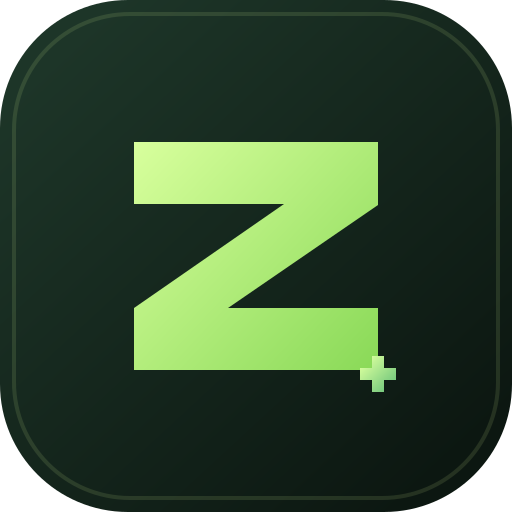

# ZEROTRICX STORE

<p align="center">
  
</p>

<p align="center">
  <strong>Modern, secure software storefront for publishing and distributing applications</strong>
</p>

[](./LICENSE)
[](https://nodejs.org/)
[](https://www.typescriptlang.org/)
[](https://vitejs.dev/)

---

## Landing — What is ZEROTRICX STORE?

ZEROTRICX STORE is a production-ready, single-owner software storefront designed to let an individual or small team publish, manage, and distribute application releases with minimal overhead. It provides a fast public storefront for discovery and a secure admin dashboard for release management, all built with modern web technologies and pluggable cloud storage.

Why use ZEROTRICX STORE?

- Launch and manage a software catalog quickly
- Publish releases and host downloads with secure storage
- Keep staging and public storage separate for safe uploads
- Built with TypeScript and modern frameworks for maintainability

---

## Quick Start (3 steps)

Perfect for GitHub visitors who want to try the project locally quickly:

```bash
# 1) Install
npm install

# 2) Start in development (frontend + backend)
npm run dev

# 3) Provision the first admin (in a private shell)
export ADMIN_USERNAME=owner
export ADMIN_EMAIL=you@example.com
export ADMIN_PASSWORD='use-a-strong-password'
npm run provision-admin
unset ADMIN_PASSWORD
```

After that, open the storefront at: http://localhost:5173 — admin is available at /admin (API at http://localhost:5000).

---

## Screenshot

Below is a placeholder screenshot — replace `client/public/screenshot.png` with an actual image exported from your local UI to show product pages or the admin dashboard.

<p align="center">
  
</p>

If you don't have a screenshot yet, the project logo is shown above. To add a screenshot, place a PNG at `client/public/screenshot.png` and commit it to the repo.

---

## Overview

This repository includes everything needed to run a software store, including:

- Public product catalog and detail pages
- Software release and download management
- Admin dashboard authentication and protected workflows
- Product image management via Cloudinary
- File storage with Cloudflare R2
- Search, filtering, and metadata-driven product discovery
- Deployment-focused configuration for production hosting

## Tech Stack

### Frontend
- React
- Vite
- TypeScript
- React Router
- Tailwind CSS

### Backend
- Node.js
- Express
- TypeScript
- MongoDB with Mongoose
- JWT and cookie-based authentication
- Cloudinary SDK
- Cloudflare R2 SDK
- Nodemailer / Resend

## Project Structure

```text
ZEROTRICX_STORE/
├── client/                # Frontend application
│   ├── public/            # Logo and static assets
│   ├── src/               # Components, pages, styles, and API client
│   ├── index.html         # Vite HTML entry
│   ├── package.json       # Frontend scripts and dependencies
│   ├── tsconfig.json      # Frontend TypeScript config
│   └── vite.config.ts     # Vite configuration
├── server/                # Backend API
│   ├── src/               # Controllers, middleware, services, validators, models
│   ├── package.json       # Backend scripts and dependencies
│   ├── tsconfig.json      # Backend TypeScript config
│   └── ...
├── package.json           # Root workspace scripts
├── render.yaml            # Render deployment configuration
├── README.md              # Project documentation
├── LICENSE                # MIT license
├── .gitignore             # Git ignore rules
└── package-lock.json      # Dependency lockfile
```

## Features

- Modern storefront UI for software browsing and discovery
- Admin-controlled application and release publishing workflow
- Secure authentication for administrative actions
- Product image uploads and storage integration
- Download management with generated access flows
- Cloud storage and staging bucket separation
- Production deployment configuration
- Test coverage via Vitest

## Prerequisites

Before running the project locally, make sure you have:

- Node.js 20+
- npm
- MongoDB instance or MongoDB Atlas connection
- Optional: Cloudinary account
- Optional: Cloudflare R2 account and buckets

## Environment Setup

Create a `.env` file in the project root and configure the required values.

```env
PORT=5000
CLIENT_URL=http://localhost:5173
SERVER_URL=http://localhost:5000
MONGODB_URI=mongodb://localhost:27017/zerotricx-store
JWT_SECRET=replace-with-a-long-random-secret
SESSION_SECRET=replace-with-another-long-random-secret

ADMIN_USERNAME=owner
ADMIN_EMAIL=you@example.com
ADMIN_PASSWORD=strong-password

CLOUDINARY_CLOUD_NAME=your-cloud-name
CLOUDINARY_API_KEY=your-api-key
CLOUDINARY_API_SECRET=your-api-secret

R2_ENDPOINT=https://<account-id>.r2.cloudflarestorage.com
R2_ACCESS_KEY_ID=your-r2-access-key
R2_SECRET_ACCESS_KEY=your-r2-secret-key
R2_PRIVATE_BUCKET=zerotricx-staging
R2_PUBLIC_BUCKET=zerotricx-downloads
R2_PUBLIC_DOMAIN=downloads.example.com

RESEND_API_KEY=your-resend-key
EMAIL_FROM=no-reply@example.com
```

Keep secrets private and never commit them to version control.

## Local Development

1. Install dependencies:

```bash
npm install
```

2. Build the application:

```bash
npm run build
```

3. Start the frontend and backend together:

```bash
npm run dev
```

The app will be available at:

- Frontend: http://localhost:5173
- API: http://localhost:5000

## First Admin Setup

Provision the first administrator account with:

```bash
export ADMIN_USERNAME=owner
export ADMIN_EMAIL=you@example.com
export ADMIN_PASSWORD='use-a-strong-password'
npm run provision-admin
unset ADMIN_PASSWORD
```

This prevents duplicate admin creation and avoids storing the password in shell history.

## Testing

```bash
npm test
```

## Production Deployment

The project includes a Render deployment configuration in `render.yaml`. For production deployment:

- host the built frontend on a static hosting provider with HTTPS
- run the Express server on a Node.js 20+ environment
- configure MongoDB with secure credentials and backups
- set all required environment variables in the hosting platform
- configure Cloudinary and Cloudflare R2 correctly
- verify CORS, domains, and upload/download flows before launch

## Security Notes

- Keep private storage credentials off the client
- Use strong JWT and session secrets
- Restrict MongoDB access to trusted sources
- Keep staging and public storage buckets separate
- Validate Cloudinary and email service configuration before production release

## Contributing

Contributions are welcome. If you would like to improve the platform, fix bugs, or expand features, please open an issue or submit a pull request with a clear description of the work.

## Repository

- GitHub: https://github.com/Shahriyar-Rahim/ZEROTRICX_STORE
